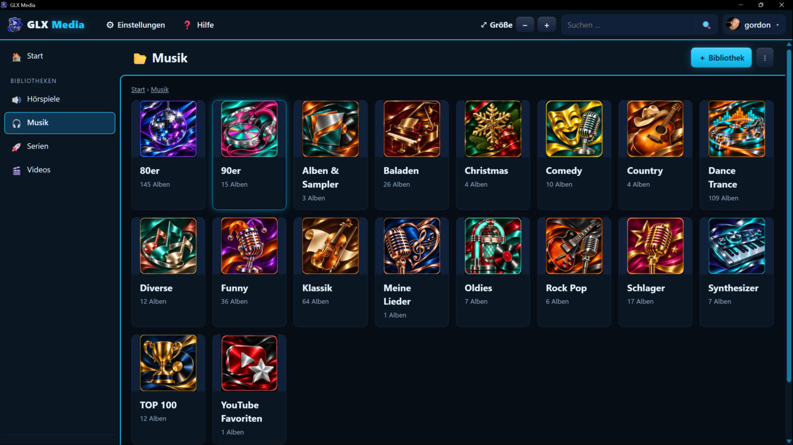
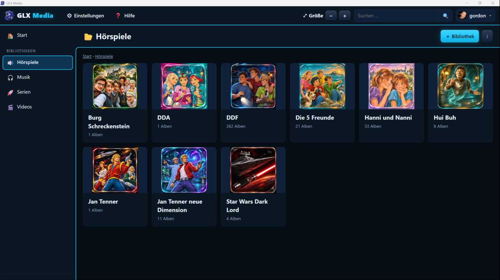

🌍 Sprachen: [🇺🇸 English](README.md) | [🇩🇪 Deutsch](README.de.md)

# 💠 GLX Media Server

### Deine eigene Multimedia-Zentrale zu Hause.

*Filme, Serien, Musik und Hörspiele vom eigenen Server, auf jedem Bildschirm im Haus.* ⚡

   

---

## ⬇️ Download

👉 Neueste Version: [Releases](../../releases/latest)  
👉 Shop und Lizenzen: [glx-tools.de](https://glx-tools.de/product/glx-media-server/)

---

## 📖 Über GLX Media Server

### Deine Mediathek, bei dir zu Hause

GLX Media Server macht aus deinen Ordnern mit Filmen, Serien, Musik und Hörspielen eine übersichtliche Mediathek mit Covern, Beschreibungen und Weiterschauen. Alles läuft auf deinem eigenen Gerät im Heimnetz, ohne Cloud und ohne fremdes Konto. Deine Dateien werden nur gelesen, nie verändert.

### Die GLX Media Familie

Das Hauptprogramm ist der GLX Media Server. Er läuft bei dir zu Hause und verwaltet Bibliotheken, Cover, Benutzer und Weiterschauen. Mit einem GLX Media Server nutzt du kostenlos GLX Media Windows für den PC, GLX Media Android TV für den Fernseher, GLX Media Smartphone für das Handy und GLX Remote als Fernbedienung. Auf iPhone und iPad installierst du GLX Media über Safari als Web-App auf dem Home-Bildschirm. Was du auf einem Gerät änderst, siehst du sofort auf allen anderen. Für Fernseher ganz ohne Server gibt es die eigenständige App GLX Media TV One.

### Ansicht nach deinen Ordnern

GLX Media zeigt deine Sammlung so, wie du sie auf der Festplatte oder dem NAS sortiert hast. Sammelordner wie „Hörspiele“ teilt GLX Media auf Wunsch selbst auf, jede Reihe wird eine eigene Bibliothek. Bibliotheken ordnest du in Hauptrubriken wie Hörspiele, Serien oder Videos, auch verschachtelt. Die Bibliotheksart „Automatisch“ erkennt Filme, Serien, Musik und Hörspiele je Unterordner selbst.

### Cover automatisch oder selbst gewählt

Liegt im Ordner ein Bild, nimmt GLX Media dieses. Sonst holt es Cover und Beschreibungen für Filme und Serien von TMDB und für Musik und Hörspiele von iTunes und Deezer, und zwar nur, wenn Titel und Jahr wirklich passen. Für Bibliotheken, Ordner und Hauptrubriken wählst du das Cover auf Wunsch selbst aus. Die Kachelgröße stellst du für jede Seite einzeln ein.

### Weiterschauen und Marker

GLX Media merkt sich für jeden Benutzer, wo er aufgehört hat, und setzt gesehene Folgen auf erledigt. Im Player setzt du einen Marker an deiner Lieblingsstelle. Beim nächsten Start fragt GLX Media, ob du weiterschauen, ab dem Marker oder von Anfang an abspielen möchtest.

### Spielt fast alles ab

Videos, die ein Gerät nicht selbst kann, zum Beispiel MKV, HEVC oder AVI, wandelt der Server mit ffmpeg beim Abspielen passend um. Musik und Hörspiele laufen mit eigener Player-Leiste weiter, während du durch die Bibliothek blätterst.

### Neues Player-Bedienfeld

Das Bedienfeld im Player ist schlank und zeigt nur klare Symbole: Titel zurück, Zurückspulen, Play oder Pause, Vorspulen und nächster Titel. Darunter siehst du Position, Restzeit und Gesamtlaufzeit. Der Filmname erscheint nur, wenn du pausierst. Wiederholen und Zufall schaltest du mit einem einzigen Button durch.

### Steuerkreuz wie bei Kodi

Bei laufendem Film spulst du mit links und rechts zurück und vor, mit hoch und runter springst du 10 Minuten vor oder zurück, ganz ohne Menü.

### GLX Remote: das Handy als Fernbedienung

Mit GLX Remote wird dein Handy zur Fernbedienung für deine Fernseher mit GLX Media: Steuerkreuz, Touchpad, Tastatur, Wiedergabe-Tasten und Sprünge direkt zu deinen Bibliotheken. Für Android gibt es die GLX Remote App. Auf dem iPhone öffnest du die Remote-Adresse in Safari, tippst auf Teilen und dann auf „Zum Home-Bildschirm“.

### Für die ganze Familie

Lege Verwalter und normale Benutzer an und bestimme für jeden, welche Bibliotheken er sieht. Kinder brauchen auf Wunsch kein Passwort. Beim Anmelden wählst du dein Profil mit Profilbild. Fernseher und PCs meldest du bequem mit dem Handy per QR-Code an, und unter „Meine Geräte“ meldest du jedes Gerät einzeln wieder ab.

### Einfach eingerichtet

Die Einrichtungs-EXE für Windows führt dich Schritt für Schritt: GLX Media auf diesem PC einrichten, per SSH auf einen Linux-Server oder Raspberry Pi bringen oder auf Proxmox einen eigenen Container anlegen. Der Assistent findet deine Medienordner und Netzlaufwerke selbst und aktualisiert eine bestehende Installation, ohne dass Benutzer und Bibliotheken verloren gehen.

### Fernzugriff und Schutz

Unter Verwaltung › Fernzugriff führt dich ein Assistent durch eigene Adresse, DNS und Reverse-Proxy mit HTTPS. Nach falschen Passwörtern wird nur das betroffene Gerät gesperrt, nicht dein ganzes Konto.

### Übersicht und Bedienung

Ein Dashboard zeigt laufende Wiedergaben, Aufgaben und das Protokoll. Neue Dateien erkennt die Ordnerüberwachung von selbst. Dazu kommen Favoriten, eine A–Z-Leiste, 12 GLX Designs, 10 Icon-Sets, Deutsch und Englisch und eine eingebaute Hilfe. Updates installiert GLX Media auf Knopfdruck oder automatisch, wenn gerade nichts läuft.

### Testen und Freischalten

Du kannst GLX Media Server 14 Tage lang mit allen Funktionen kostenlos testen. Danach brauchst du zum Abspielen ein Abo für 2,99 Euro im Monat oder 29,99 Euro im Jahr, deine Bibliotheken, Benutzer und Einstellungen bleiben erhalten. Nach dem Kauf bekommst du einen GLX-Token per E-Mail, den du unter Verwaltung › Lizenz & Update einträgst. GLX Media Windows, GLX Media Android TV, GLX Media Smartphone und GLX Remote sind kostenlos.

---

## 📸 Überblick & Screenshots

### 1️⃣ Musik-Bibliothek

### 2️⃣ Hörspiele

---

## ✨ Funktionen

- 🚀 **Eigener Server:** Läuft auf einem Proxmox-Container, Linux-Server, Raspberry Pi oder Windows-PC.
- 🧩 **Alle Medien an einem Ort:** Filme, Serien, Musik und Hörspiele mit Covern und Beschreibungen.
- ⚙️ **Ordneransicht:** Die Mediathek nach Ordnern durchsuchen, wie auf der Festplatte.
- 🔒 **Weiterschauen überall:** Am Fernseher anhalten und am PC an derselben Stelle weiterschauen.
- 📂 **Kostenlose Apps:** GLX Media Windows und GLX Media Android TV sind kostenlose Begleit-Apps.
- ⚡ **Handy als Fernbedienung:** GLX Remote macht dein Android-Handy zur Fernbedienung.
- 🎨 **iPhone-Web-App:** GLX Media auf dem iPhone über Safari als Web-App installieren.
- 🌍 **Zwei Sprachen:** Deutsch und Englisch.

---

## 🧩 Systemanforderungen

- Linux-Server, Proxmox-LXC-Container, Raspberry Pi oder Windows-PC
- Deine Mediendateien auf einer lokalen Platte oder Netzwerkfreigabe

---

## 🧪 Testzeitraum & Lizenz

14 Tage kostenlos mit allen Funktionen, danach 2,99 Euro im Monat oder 29,99 Euro im Jahr über [glx-tools.de](https://glx-tools.de).

---

## 🔗 Mehr zu diesem Produkt

👉 [glx-tools.de](https://glx-tools.de/product/glx-media-server/)  
Support: **info@glx-tools.de**

---

## 📄 Lizenz

Copyright © 2026 GLX Tools – Gordon Lehmann. Alle Rechte vorbehalten.  
Dies ist proprietäre kommerzielle Software. Es wird keine Open-Source-Lizenz gewährt. Dieses Repository enthält nur Release-Downloads und Dokumentation; der Quelltext wird nicht veröffentlicht.

---

Mit ❤️ gemacht von **Dreamdancer100**

