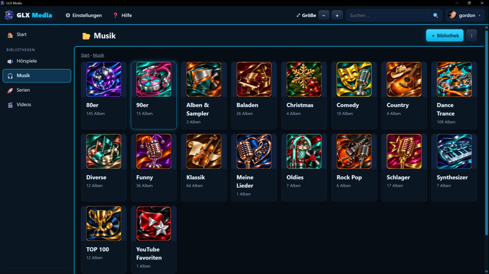
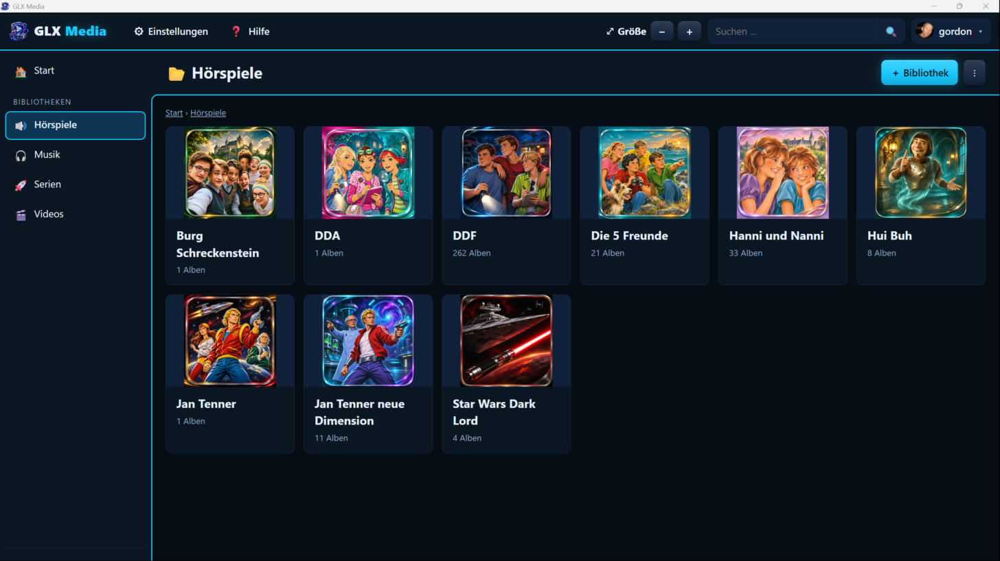

🌍 Languages: [🇺🇸 English](README.md) | [🇩🇪 Deutsch](README.de.md)

# 💠 GLX Media Server

### Your own media center at home.

*Movies, series, music and audio books from your own server, on every screen in the house.* ⚡

   

---

## ⬇️ Download

👉 Latest version: [Releases](../../releases/latest)  
👉 Shop and licences: [glx-tools.de](https://glx-tools.de/product/glx-media-server/)

---

## 📸 Overview & Screenshots

### 1️⃣ Music library

### 2️⃣ Audio books

---

## ✨ Features

- 🚀 **Your own server:** Runs on a Proxmox container, Linux server, Raspberry Pi or Windows PC.
- 🧩 **All media in one place:** Movies, series, music and audio books with covers and descriptions.
- ⚙️ **Folder view:** Browse your library by folders, just like on the hard drive.
- 🔒 **Resume anywhere:** Stop on the TV and continue on the PC at the same spot.
- 📂 **Free apps:** GLX Media Windows and GLX Media Android TV are free companion apps.
- ⚡ **Phone as remote:** GLX Remote turns your Android phone into a remote control.
- 🎨 **iPhone web app:** Install GLX Media on the iPhone as a web app via Safari.
- 🌍 **Two languages:** German and English.

---

## 🧩 Requirements

- Linux server, Proxmox LXC container, Raspberry Pi or Windows PC
- Your media files on a local drive or network share

---

## 🧪 Trial & License

14 days free with all features, then 2.99 EUR per month or 29.99 EUR per year from [glx-tools.de](https://glx-tools.de).

---

## 🔗 More about this product

👉 [glx-tools.de](https://glx-tools.de/product/glx-media-server/)  
For support: **info@glx-tools.de**

---

## 📄 License

Copyright © 2026 GLX Tools – Gordon Lehmann. All rights reserved.  
This is proprietary commercial software. No open-source license is granted. This repository contains release downloads and documentation only; the source code is not published.

---

Made with ❤️ by **Dreamdancer100**

